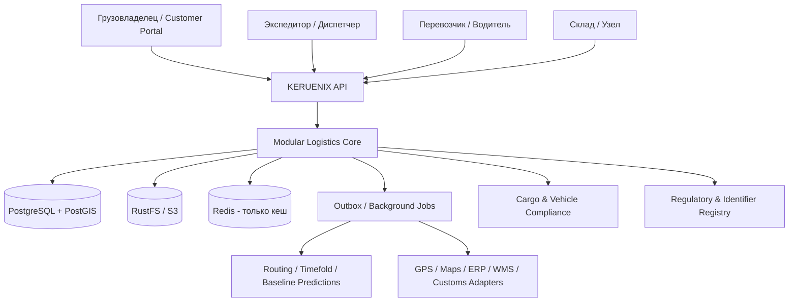

# 02 — System Architecture / техническая архитектура

**Статус:** DRAFT, не утверждённые ADR · **Версия:** 0.2 · **Обновлено:** 07.11.2026.

## Архитектурная позиция

Рекомендуется **Java-first modular monolith** со строгими доменными модулями, выделенными портами для внешних API и асинхронным исполнением сложных задач. Переход к микросервисам — только при доказанных потребностях масштабирования/команд/надёжности. Одна поставка бизнес-ядра поддерживает pooled SaaS и dedicated/on-prem.

**Более детальное решение:** [варианты архитектуры v1](13-modular-architecture-options-v1.md) и [план реализации модулей](14-modular-delivery-blueprint.md). Предлагается Spring Modulith с логическими модульными API и событиями; число логических модулей не равно числу JVM контейнеров. [Каталог зависимостей](contracts/module-boundaries.v1.json) проверен на циклы как проектная модель, но не на исходном коде.

## Контекст системы (предложение)

Диаграмма — **логическая**, не доказательство совместной транзакционности между разными системами. Каждое обращение к стороннему сервису имеет таймауты, idempotency/correlation и явный уровень доверия.

## Модули, bounded contexts и ownership

| Контекст | Ответственность | Source of truth |
|---|---|---|
| Tenancy / Identity | Tenant, legal entities, memberships, scopes and partner grants | Membership DB + approved IdP |
| Commercial | RFQ, QuoteVersion, CarrierOffer, contract snapshot and approvals | Commercial DB |
| Booking / Fleet | Availability, capabilities, driver/vehicle assignments and reservations | Reservation DB |
| Shipment & Cargo | Physical cargo units, handling, custody and shipment lifecycle | Shipment events / custody |
| Dispatch & Route | Trip, route versions, stops, ETA, operational exceptions | Planned/approved trip + verified observations |
| Tracking | Permission-filtered customer milestones and ETA | Derived projection, **not** primary evidence |
| Warehouse Hub | ASN, stock ledger, holds, docks, tasks, handover | Warehouse inventory ledger |
| Compliance | Cargo classification, adjacency, vehicle legality, docs, rules | Approved RegulatoryRuleSets + evidence |
| Identifiers | SSCC/GTIN/GLN/ISO6346/HS/TNVED namespace and label registry | Typed external IDs + issuer evidence |
| Finance | Sale/buy prices, cost snapshots, AR/AP status, disputes | Reconciliation + ERP if designated |
| Rescue | Incident, offers, replacement leg, custody and recovery costs | Recovery workflow |
| Intelligence | Constraint optimization and optional predictions | Suggestions; **never** legal truth |
| Integrations | GPS, map, routing, EDI, warehouse, customs and payments APIs | Source provenance |
| Platform Management | Onboarding, provisioning, quotas and commercial SaaS billing | Platform-specific DB/config |

## Trust boundaries

- `tenant_id` определяется валидированной membership/identity, а не случайным заголовком клиента.
- RBAC + attribute- and resource-level access; RLS защищает данные на уровне БД, но не заменяет авторизацию приложения.
- Partner collaboration grants создают **проекции только нужных полей**, а не прямой SQL-доступ к чужим таблицам.
- Складской владелец и хранитель разделены; клиентская проекция Shipment не содержит чужой GPS-истории.
- Object storage — tenant-scoped, signed access only after server-side rights verification; кеш и события имеют scope.
- Control plane SaaS отделён от выполнения локальных рейсов; On-Prem не должен прекращать работу из-за отключения лицензирующего облака в пределах согласованного договора.

## Данные и консистентность

- PostgreSQL/PostGIS: транзакционные данные, маршруты/геозоны, versioned plans and ledger.
- Redis: ускорение и rate limiting, **не источник истины** для броней, остатков или документов.
- RustFS/S3: подтверждающие файлы/изображения/модели с checksum/retention.
- Transactional outbox/inbox и идемпотентные команды для уведомлений/синхронизации.
- Каждый агрегат содержит версию; конкурирующие назначения транспорта, резервирование stock и подтверждения должны проверяться атомарно.
- Брокер выбирается по измерениям, а не «по умолчанию Kafka»; первая версия может использовать надёжные PG-jobs/outbox.
- Event facts сохраняют `occurred_at`, `received_at`, `source`, `tenant`, `schema_version`, `correlation_id`.

## Конфигурация и интеграционные порты

`RouteProviderPort`, `TelematicsProviderPort`, `VehicleCapabilityPort`, `CargoCompatibilityPort`, `WarehousePort`, `LogisticsIdentifierPort`, `RegulatoryCompliancePort`, `EtaPredictor`, `FleetOptimizer`, `DocumentRepositoryPort`, `NotificationPort`.

Java 21, поддерживаемая версия Spring Boot, PostgreSQL/PostGIS, React/Next.js и Flutter — предложенный стек; версии, лицензии, совместимость Timefold, карта/трафик и доступность внешних интеграций следует проверять в отдельном техническом PoC.

## Lifecycle process orchestration (v1)

Предлагается `CommercialWorkflow` и `ExecutionWorkflow` как явные application-level process managers, которые вызывают агрегаты RFQ/Quote/Booking/Reservation и Shipment/Trip/Delivery без прямого доступа к чужим таблицам. Для внешнего Carrier confirmation, документов и финансового ERP использовать outbox/inbox, команды с expectedVersion + idempotency key и компенсационные операции (release reservation, invalidate pending confirmation, open exception); не обещать распределённую ACID транзакцию. Набор команд/переходов закреплён в [Lifecycle v1](10-commercial-execution-lifecycle-v1.md) и [машинном контракте](contracts/commercial-execution-lifecycle.v1.json). Публикация агрегированных статусов для Customer Tracking отделена от фактов cargo custody, а finance ledger — от физического shipment.

## Security / reliability gates

Два tenant, пересекающиеся Order reference и одно GPS-устройство с несколькими CargoUnit должны пройти изоляционные проверки. Duplicate webhooks, two dispatchers on same vehicle, stale GPS, out-of-order cargo scan, provider outage, blocked customs release, invalid label and timeout optimization обязаны давать **объяснимые безопасные** результаты.

**См.:** [Domain](03-domain-lifecycle.md), [Deployment](09-deployment-operations.md), [Compliance](06-standards-compliance-governance.md), [Deep architecture](../idea/09-reference-architecture.md).
