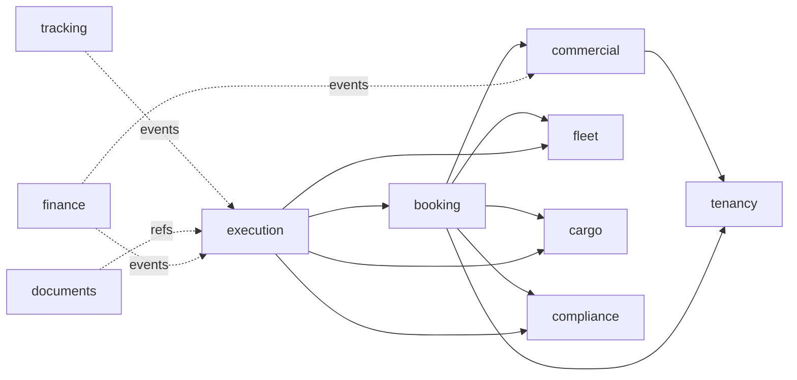

# 13 — Варианты модульной архитектуры KERUENIX

**Дата:** 07.11.2026 · **Версия:** 1.0 · **Статус:** ARCHITECTURE PROPOSAL; решение пока не утверждено.  
**Основано на:** [System Architecture](02-system-architecture.md), [Project Audit](12-project-audit-2026-11-07.md), [Domain Lifecycle](03-domain-lifecycle.md), [MVP Qualification](05-mvp-qualification.md).

## 1. Контекст решения

KERUENIX должен работать как облачный Multi-Tenant SaaS для перевозчиков и экспедиторов без собственного IT-парка, как выделенная установка крупной транспортной компании и как offline-tolerant On-Prem deployment. Функции растут от одной дорожной перевозки (`RFQ → Quote → Booking → Trip/Shipment → POD → Finance`) до WMS, Rescue Network, догрузов/backhaul, биржи, международных правовых правил и интеллектуальной оптимизации.

**Архитектурная цель:** развивать функциональные домены независимо и развертывать один бизнес-продукт в разных режимах, сохраняя безопасность и недопуская дорогостоящих распределённых транзакций на старте.

Модуль — это граница бизнес-правил и владения данными, **не** отдельная таблица, контроллер, Maven artifact или процесс по определению. Число агрегатных state machines не обязано равняться числу модулей.

## 2. Альтернативы

| Опция | Техническая форма | Выигрыш | Цена/риск | Решение |
|---|---|---|---|---|
| A. Layered monolith | Папки controllers/services/repositories, общие JPA сущности | Очень быстро сделать первый CRUD | Скрытые циклы, прямые обращения между сервисами и таблицами, трудная эволюция | REJECT |
| B. Spring Modulith, один Maven module | Один backend артефакт, domain packages как application modules; exported APIs + events | Простой запуск, архитектурные проверки, быстрые тесты отдельных контекстов | Граница требует дисциплины; не физическая изоляция | **RECOMMENDED R0** |
| C. Maven multi-module modular monolith | Модули как отдельные artifacts, собранные в один Spring Boot process | Compile-time enforcement и физическая структура зависимостей | Сложность POM/тестов/JPMS/инициализации; преждевременные границы дают overhead | OPTION после зрелого R0 |
| D. Microservices by context | REST/gRPC/broker + отдельные DB/runtime для каждого домена | Independent releases/scaling/failure domains | Saga, latency, secrets, K8s/monitoring, contract/versioning, сложное дебажение | REJECT для старта |
| E. Modular Core + isolated workers | Вариант B/C + отдельные процессы для GPS bulk ingest/route optimization/notification/document transforms | Управляемые тяжёлые/внешние нагрузки, ядро остаётся простым | Outbox/inbox, retries, backpressure и observability обязательны | **TARGET EVOLUTION** |

**Рекомендация:** `B → E`, переход `B → C` только по доказанной потребности compile-time/library separation. Переход к `D` рассматривается лишь по модулю, а не по всей системе сразу.

## 3. Технологическая база

- **Java 21** как предложенный baseline для нового проекта; текущую патч-версию и LTS политики проверить перед реализацией.
- **Spring Boot 4.x + Spring Modulith 2.x** — кандидат после compatibility/security PoC. Альтернативный консервативный вариант: Spring Boot 3.5.x + Spring Modulith 1.4.x при ограничениях библиотек. **Не смешивать BOM-major без проверки**; [официальный compatibility overview](https://docs.spring.io/spring-modulith/reference/appendix.html), [Spring Modulith](https://spring.io/projects/spring-modulith/).
- Spring Security/OIDC, Postgres/PostGIS (при необходимости spatial query), Flyway, JUnit/Testcontainers, OpenTelemetry/Micrometer; Timefold как optional optimizer за интерфейсом.
- Maven single build для R0; доменные Java-пакеты внутри `kz.keruenix` распознаются Spring Modulith.
- Не делать каждый модуль отдельным Spring Boot application; `@SpringBootApplication` одна на business-core runtime.

**Контроль архитектуры:** `ApplicationModules.of(KeruenixApplication.class).verify()` блокирует зависимости в internal packages и циклы; `@ApplicationModuleTest` проверяет модули изолированно. В CI отдельно нужны реальные JDBC/RLS/DB transaction tests: Modulith не проверяет корректность SQL-прав автоматически. Official [verification](https://docs.spring.io/spring-modulith/reference/verification.html) and [module tests](https://docs.spring.io/spring-modulith/reference/testing.html).

## 4. Разные варианты «модульности» — не путать

1. **Logical Domain Module:** API + internal model + storage owner + transitions + events + tests (R0, обязательно).
2. **Build Module:** отдельный Maven POM/artifact (на старте необязательно).
3. **Deployable Service:** отдельный JVM/container/runtime (на старте — один business core).
4. **Feature Entitlement:** разрешена ли функция этому tenant/профилю подписки (не является защитой без серверной авторизации).
5. **Integration Adapter:** сменный внешний провайдер GPS/maps/ERP/WMS и т.д. (не означает самостоятельный микросервис).
6. **Worker:** отдельный исполнитель тяжёлых задач, получает задания по устойчивому контракту и не владеет коммерческими состояниями ядра.

Архитектурный модуль должен существовать даже если он выключен в UI. Feature flags не могут отключать tenant authorization, финансовую корректность и обязательные safety/compliance проверки.

## 5. Проектная модульная карта

### R0 — обязательные bounded contexts

| Модуль | Владение и границы | Канонический API / событие |
|---|---|---|
| `tenancy` | Tenant, LegalEntity, Member, PartnerGrant, роль/поле/action policy | `AccessPolicy.check`, `GrantRevoked` |
| `commercial` | RFQ, QuoteVersion, CarrierOffer, contract snapshots | `CommercialApi.acceptQuote`, `QuoteAccepted` |
| `fleet` | VehicleCombination, equipment, availability и **атомарные** capacity holds | `FleetCapacityApi.hold/confirm/release` |
| `cargo` | CargoProfile, HandlingUnit, classification/evidence | `CargoCatalogApi.getProfile` |
| `booking` | Booking state + orchestration/saga между contract/fleet/cargo/compliance | `BookingApi.confirm`, `BookingConfirmed` |
| `execution` | Trip, TransportLeg, Shipment, Custody, DeliveryAttempt/POD; physical source of truth | `ExecutionApi.recordPickup/Delivery`, `ShipmentDelivered` |
| `tracking` | Только customer-visible read models, ETA freshness, tracking access grants | `TrackingQueryApi.getShipment` |
| `documents` | DocumentPackageVersion, attachment/evidence refs, review, retention | `DocumentApi.verifyPackage` |
| `finance` | Sell/buy contract cost, margin report, opaque external accounting-document reference | `CommercialCostReportApi`, `ExternalAccountingReferenceApi`; no payment ledger |
| `compliance` | Cargo/vehicle safety decisions, valid RuleSet applicability; basic R0 fail-closed | `ComplianceApi.assess`, `ComplianceDenied` |

Для R0 `execution` включает несколько агрегатов, но их модель отделена. Когда volume/team/complexity потребуют, его можно **логически** разделить на `dispatch`, `shipment`, `delivery` ещё до микросервисов.

### Расширения, не обещанные к R0

| Модуль/расширение | Старт |
|---|---|
| `optimization` (Timefold, provider-independent fleet optimizer) | R1, сначала in-process job с timeouts |
| `recovery` (Rescue, handover, subcontract and responsibility) | R1 |
| `warehouse` (WMS/YMS, multi-owner stock, cross-dock) | R1/R2 по пилоту |
| `marketplace` (private load board → public exchange) | R2+ |
| `regulatory` (ADR/TNVED/CMR/customs by approved jurisdiction) | R2+ после экспертных правил |
| `saas-control` (subscription, metering, tenants self-service) | SaaS platform track, отделён от `finance` перевозки |
| `ml-prediction` (Tribuo ETA/fuel models) | После доказанных data labels и baseline |

**Интеграционные adapters** GPS, route, S3, ERP, notifications не обязаны быть отдельными доменными модулями. Они реализуют порты владельца бизнес-контекста.

## 6. Зависимости — направленные, не круговые

Это **концептуальные связи**, подлежащие проверке; стрелки к `tenancy` для security policy не означают, что tenancy знает о всех остальных бизнес-сущностях.

- Sync вызовы — только через exported Java interfaces и DTO/snapshots, не через чужой `Repository`, `EntityManager`, JPA relationships.
- Async — versioned domain events + durable publication registry/outbox/inbox. Проектные события `QuoteAccepted`, `CapacityConfirmed`, `CargoPickedUp`, `DeliveryConfirmed` являются уведомлением о факте, не заменяют команду с проверки guard.
- Для подтверждения ресурса необходима атомарная блокировка в `fleet`; для подтверждения брони `booking` делает guarded state transition после проверки действительности hold/terms.
- Внешние системы (Carrier API, SMS/Email/ERP, telematics) не входят в локальную ACID транзакцию; saga/compensation + idempotency + retry/DLQ.
- `tracking` только читает разрешённые projections; не меняет Shipment/Trip, не хранит источник истины.

## 7. Event-driven модель без опасных допущений

**Внутренние доменные события** Spring Modulith могут использовать Event Publication Registry. Однако его registry сам по себе не заменяет полноценный outbox для любых внешних интеграций; требуется проверить семантику выбранной версии и способа externalization. Внешние сообщения, влияющие на расчёты/субподряд/интеграции, публиковать через надёжный outbox/worker с проверенной доставкой, dead letters, идемпотентностью и versioned event schemas. См. [официальный Spring Modulith Events guide](https://docs.spring.io/spring-modulith/reference/events.html).

**Event envelope:** `eventId, tenantId, aggregateId, aggregateVersion, schemaVersion, occurredAt, recordedAt, source, actor, correlationId, causationId, evidenceRefs`. На event payload никогда не полагаться как на tenant authorization из непроверенного источника.

## 8. Persistence и schema ownership

R0: **один физический PostgreSQL** на инсталляцию; отдельные **логические области владения таблицами**. Shared schema с префиксами или named schemas допустимы при Flyway migration ownership; на старте не нужно отдельной базы на каждый модуль.

- Каждый tenant-owned row содержит `tenant_id` и политики RLS; app SQL role не имеет `BYPASSRLS`; учесть владельца таблицы/`FORCE ROW LEVEL SECURITY`, connection pool и `SET LOCAL` tenant context в transaction boundary.
- Права partner collaboration реализовать проверенным `PartnerGrant` + scoped projections; не открывать прямые SQL SELECT на чужой TenantId.
- Таблицы модуля может изменять только **владелец этого модуля**, включая migrations. Foreign keys внутри агрегата допустимы; межмодульные ссылки преимущественно по стабильным UUID + application invariants, чтобы не связывать владельцев данных физической FK-сетью.
- Cross-module reporting строить read models/materialized projections (с reconciliation), а не джойном десятков доменных таблиц в чужом service.
- `@Transactional` в одном JVM не должно становиться разрешением обходить модульные API и владение данными.

### Logical module ownership vs storage strategy

Write model и read model могут принадлежать разным модульным границам **без прямой записи в чужие JPA таблицы**: projection обновляется только через опубликованные события/DTO владельца, с watermark, rebuild и permission filtering. Партиционирование не является механизмом изоляции модулей/tenants; это инструмент производительности/retention отдельных высокообъёмных таблиц.

**PostGIS** включён в платформенную БД: `Fleet` владеет фактической GPS-телеметрией, `Execution` — версией маршрута/геозонным milestone, `Tracking` — клиентским представлением, `Warehouse` — своей физической геометрией. Использовать geospatially-aware ports и hard tenant policy, а не общий `GISRepository` с правами на все данные. ТЗ: [15](15-data-platform-partitioning-postgis.md) и [16](16-module-storage-gis-addendum.md).

## 9. Multi-Tenant / Dedicated / On-Prem

Три deployment profiles используют **одинаковые domain invariants**:

| Profile | Размещение | Особенность |
|---|---|---|
| `SAAS_POOLED` | Shared app instances, PostgreSQL RLS/tenant scope | Самообслуживание, quotas, audit, метрики cost-to-serve |
| `DEDICATED` | Отдельный runtime и DB/объекты для одного enterprise | Собственные ключи, release/upgrade gates |
| `ON_PREM` | Локальный runtime, PG и S3-compatible endpoint | Управляемые offline periods, автономные операции |

В On-Prem нельзя удалить tenant/party field permissions: один холдинг может обслуживать несколько юридических лиц и чужих перевозчиков. SaaS `saas-control` может физически быть отдельным control plane позднее, но выполнение Trip/Shipment не должно зависеть от постоянного online соединения с control-plane сервером.

## 10. Когда извлекать отдельные процессы/сервисы

Рассматривать extraction после измерений и выполнения всех условий:
1. Модуль имеет подтверждённого владельца данных, публичные DTO/events, contract tests, миграции и отсутствие двусторонних JPA связей.
2. Наблюдаются независимые scaling/failure/release требования, которые обходятся дороже распределённости.
3. Есть безопасный async контракт, outbox/inbox и idempotent retry, fallback и observability.
4. Реально пройден rollback/recovery game-day и нет нарушения tenant security.
5. Отдельный deployment/DB нужен по нормативу или enterprise договору.

**Кандидаты на раннюю изоляцию в отдельных workers:** bulk GPS ingest, optimization, PDF/label generation и уведомления. **Не кандидаты на раннюю физическую разбивку:** RFQ↔Quote↔Booking↔Capacity и Shipment↔Custody↔POD, где важна согласованность.

## 11. Правила разработки и критерии приёмки

**Definition of Module Ready:** owner, purpose, public API, aggregate/DB ownership, inbound commands/outbound events, allowed dependencies, tenant/partner scope, error model, outbox semantics, migration and test matrix.

**Architecture tests:** `ApplicationModules.verify()`, forbid dependency cycles and access to internal packages, optional `@ApplicationModule(allowedDependencies=...)`, no shared business entities; `@ApplicationModuleTest` per core module; ArchUnit checks for forbidden repository dependency; generated module diagrams.

**Integration/E2E:** PostgreSQL Testcontainers+RLS for 2–4 tenants, concurrent capacity holds, expired quote, POD vs GPS, duplicate custody/evidence events, outbox replay, S3 document grants, On-Prem standalone API contract smoke. Track exact SHA.

**Next implementation task:** PR-00 business decisions and PR-01 platform foundation may start in parallel in the existing delivery plan. Binding Quote/Carrier/Booking/POD operations require their applicable business/legal approvals before activation, not before foundational code. No automatic creation of new branch is required. No microservices, Kafka cluster or K8s are prerequisites for first domain slice.

## 12. Status

**Design decision suggested, not signed:** `Modular Monolith (Spring Modulith) + Worker Extraction`. No code, module verification tests, deployment or dependency compatibility PoC have been executed by this document.
